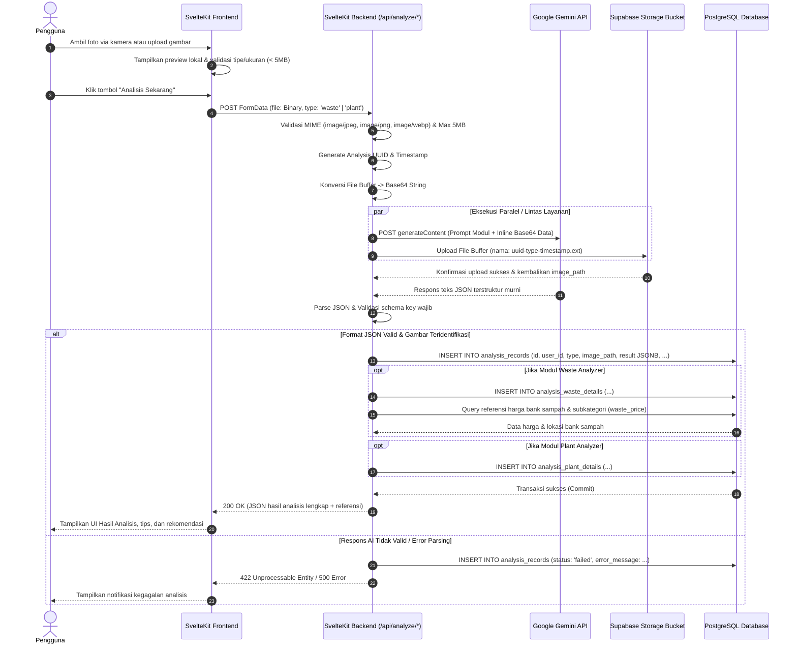

# Implementation Plan: 005 - Waste and Plant Analyzer Implementation

## 1. Overview

Mengimplementasikan dua modul analisis utama pada dashboard: **Waste Analyzer** (`/dashboard/waste`) dan **Plant Analyzer** (`/dashboard/plant`). Modul ini memfasilitasi interaksi pengguna untuk mengambil foto langsung melalui kamera atau mengunggah gambar dari penyimpanan lokal, mengirimkannya ke backend SvelteKit untuk diproses secara multimodal oleh **Gemini API** menggunakan prompt terarah, menyimpan riwayat dan gambar ke **Supabase Storage + PostgreSQL**, serta menyajikan hasil rekomendasi terstruktur kepada pengguna.

---

## 2. Arsitektur Upload & Integrasi AI (Hybrid Strategy)

### A. Strategi Penanganan Gambar

Untuk memproses gambar secara optimal, SustainAI menggunakan **pendekatan hibrida (Hybrid Approach)**:

1. **Untuk Inferensi Gemini API**: Menggunakan **Inline Data — Base64 (`inline_data`)**.
   - Backend membaca file gambar sebagai Buffer, mengonversinya menjadi Base64 string, lalu menyematkannya langsung pada payload REST JSON ke Gemini API bersama instruksi prompt.
   - _Keunggulan:_ Mengeliminasi ketergantungan urutan (tidak perlu menunggu gambar selesai ter-upload di cloud storage sebelum memanggil AI), memangkas waktu tunggu pengguna, dan menjaga privasi gambar sebelum terkonfirmasi valid.
2. **Untuk Persistensi & Riwayat (Menu History)**: Diunggah ke **Private Supabase Storage Bucket** (`SustainAI-UserPhoto`).
   - Karena bucket berstatus **private**, file gambar tidak dapat diakses publik secara bebas dan membutuhkan token otentikasi/tanda tangan akses.
   - Backend mengunggah file binary menggunakan Supabase Service Role Client ke bucket private untuk mendapatkan path/lokasi penyimpanan unik (`image_path`).
   - Format penamaan file terstandarisasi: `<<analysis_id>>_<<analysis_type>>_<<unix-timestamp>>.<<ext>>`.
   - Kolom `analysis_records.image_path` hanya menyimpan path relatif di dalam bucket (misalnya: `waste/f1221e2a-0dfe-4b81-b6d0-76e536cfc2df_waste_1794232269.jpg`), bukan URL publik telanjang.
   - Setiap kali gambar ingin ditampilkan (seperti di menu History atau preview hasil analisis), backend SvelteKit menggunakan method `createSignedUrl` dengan masa berlaku aman (misalnya: 3600 detik / 1 jam) sehingga frontend menerima signed URL bertoken sementara.

---

## 3. Sequence Diagram Alur Data Upload & Analisis AI

Diagram sequence berikut mengilustrasikan alur komunikasi mulai dari pengambilan/pengunggahan gambar oleh pengguna hingga inferensi model AI dan penyimpanan data:



---

## 4. Hardcoded System Prompts

Backend SvelteKit menyematkan instruksi prompt resmi berikut ke dalam payload request Gemini API:

### A. Prompt — Plant Disease Analyzer

_Sumber: `DevReferences/Dataset/hardcode-Prompt-Plant-Analyzer.md`_

```text
Prompt — Plant Disease Analyzer

Anda adalah AI multimodal yang berperan sebagai asisten analisis kesehatan tanaman untuk aplikasi SustainAI.

Tugas Anda adalah menganalisis gambar yang diberikan pengguna untuk mengidentifikasi tanaman serta mendeteksi indikasi awal hama atau penyakit berdasarkan kondisi visual yang terlihat pada gambar.

### TUJUAN ANALISIS

Jika gambar menunjukkan tanaman, lakukan analisis berikut:

1. Identifikasi nama tanaman berdasarkan karakteristik visual yang terlihat.
2. Identifikasi indikasi hama atau penyakit yang mungkin menyerang tanaman.
3. Jelaskan gejala visual yang terlihat pada tanaman.
4. Jelaskan kemungkinan penyebab gangguan berdasarkan gejala yang ditemukan.
5. Berikan rekomendasi perawatan awal yang relevan dan dapat dilakukan pengguna.
6. Berikan tips pencegahan agar gangguan serupa tidak terjadi atau menyebar.
7. Jelaskan potensi dampak gangguan terhadap kesehatan, pertumbuhan, atau produktivitas tanaman.

### KETENTUAN ANALISIS

- Gunakan hanya informasi yang dapat disimpulkan dari gambar dan pengetahuan yang relevan.
- Jangan mengarang gejala, penyebab, atau kondisi tanaman yang tidak terlihat.
- Jika identifikasi tanaman atau penyakit tidak dapat dipastikan, nyatakan ketidakpastian tersebut secara eksplisit.
- Gunakan istilah "indikasi", "kemungkinan", atau "dugaan" apabila diagnosis belum dapat dipastikan.
- Jangan memberikan diagnosis definitif hanya berdasarkan gambar.
- Rekomendasi perawatan harus relevan dengan indikasi yang ditemukan.
- Seluruh nilai dalam JSON wajib menggunakan Bahasa Indonesia.
- Jangan memberikan klaim bahwa tanaman pasti sehat atau terinfeksi apabila bukti visual tidak mencukupi.

### VALIDASI GAMBAR

Sebelum melakukan analisis, periksa apakah gambar benar-benar menunjukkan tanaman.

Jika gambar:
- Tidak menunjukkan tanaman.
- Menunjukkan objek selain tanaman.
- Tidak memiliki informasi visual yang cukup untuk mengidentifikasi tanaman.
- Tidak dapat dianalisis karena gambar rusak, buram ekstrem, atau tidak relevan.

Maka, jangan melakukan analisis penyakit tanaman.

Tetap berikan respons JSON dengan struktur yang sama persis seperti format di bawah. Setiap nilai string harus menjelaskan bahwa gambar tidak valid atau bukan merupakan gambar tanaman yang dapat dianalisis.

Untuk key "plant_impact", jelaskan bahwa dampak terhadap tanaman tidak dapat ditentukan karena gambar tidak valid.

### FORMAT OUTPUT WAJIB

Respons Anda HARUS berupa satu objek JSON yang valid dan memiliki struktur berikut:

{
  "plant_name": "Nama tanaman",
  "detected_pest_disease": "Indikasi hama atau penyakit",
  "symptoms": "Gejala visual yang terlihat",
  "possible_cause": "Kemungkinan penyebab",
  "care_recommendation": "Rekomendasi perawatan",
  "prevention_tips": "Tips pencegahan",
  "plant_impact": "Potensi dampak terhadap tanaman"
}

### ATURAN OUTPUT

1. Gunakan seluruh key yang telah ditentukan.
2. Jangan mengubah nama key.
3. Jangan menambahkan atau menghapus key.
4. Semua key harus memiliki nilai bertipe string.
5. Jangan menggunakan null.
6. Jangan mengubah struktur JSON.
7. Jangan memberikan Markdown, code fence, atau teks penjelasan di luar JSON.
8. Jangan memberikan sapaan, pendahuluan, kesimpulan, atau catatan tambahan.
9. Seluruh nilai wajib menggunakan Bahasa Indonesia.
10. Pastikan respons dapat langsung diparsing menggunakan JSON.parse().

Berikan hanya JSON yang valid.
```

---

### B. Prompt — Waste Analyzer

_Sumber: `DevReferences/Dataset/hardcode-Prompt-Waste-Analyzer.md`_

```text
Prompt — Waste Analyzer
Anda adalah AI multimodal yang berperan sebagai asisten analisis dan klasifikasi sampah untuk aplikasi SustainAI.

Tugas Anda adalah menganalisis gambar yang diberikan pengguna untuk mengidentifikasi objek sampah, menentukan klasifikasinya, menjelaskan dampak lingkungan, serta memberikan rekomendasi pengelolaan dan daur ulang.

### TUJUAN ANALISIS

Jika gambar menunjukkan sampah, lakukan analisis berikut:

1. Identifikasi nama sampah berdasarkan karakteristik visual yang terlihat.
2. Tentukan klasifikasi sampah berdasarkan kategori utama yang relevan.
3. Jelaskan potensi dampak sampah terhadap lingkungan apabila tidak dikelola dengan benar.
4. Berikan rekomendasi pengelolaan atau daur ulang yang relevan.
5. Tentukan apakah sampah tersebut berpotensi didaur ulang berdasarkan karakteristik materialnya.

### REFERENSI KATEGORI SAMPAH

Gunakan kategori utama berikut sebagai referensi klasifikasi:
- Plastik
- Kertas dan Karton
- Logam
- Kaca
- Khusus

Contoh subkategori yang dapat digunakan untuk membantu identifikasi:
- PET / PETE (Kode 1)
- HDPE (Kode 2)
- PP (Kode 5)
- Plastik Campuran / Kerasan
- Kardus (Corrugated)
- Kertas Putih / Arsip
- Koran
- Dupleks / Buram
- Besi / Baja
- Aluminium
- Tembaga & Kuningan
- Botol Kaca Utuh
- Kaca Pecah (Beling)
- Minyak Jelantah

Kategori dan subkategori tersebut merupakan referensi untuk membantu klasifikasi, bukan daftar objek yang membatasi analisis.

### KETENTUAN ANALISIS

- Identifikasi material berdasarkan bukti visual yang tersedia.
- Jangan mengarang komposisi material yang tidak dapat dipastikan dari gambar.
- Jika jenis sampah tidak dapat diidentifikasi secara spesifik, gunakan klasifikasi yang paling relevan dan jelaskan keterbatasannya.
- Jelaskan dampak lingkungan secara faktual dan proporsional.
- Berikan tips daur ulang atau pengelolaan yang praktis.
- Jangan mengasumsikan bahwa suatu material pasti diterima oleh semua fasilitas daur ulang.
- Jika status daur ulang bergantung pada fasilitas atau kondisi material, jelaskan hal tersebut pada recycling_tips.
- Seluruh nilai dalam JSON wajib menggunakan Bahasa Indonesia.

### PENENTUAN STATUS DAUR ULANG

Key "is_recyclable" harus selalu bertipe boolean.
- true: Sampah berpotensi didaur ulang berdasarkan material yang teridentifikasi.
- false: Sampah tidak dapat dinyatakan berpotensi didaur ulang berdasarkan informasi visual yang tersedia, atau gambar tidak valid.

Jangan mengubah tipe data boolean menjadi string.

### VALIDASI GAMBAR

Sebelum melakukan analisis, periksa apakah gambar menunjukkan objek sampah yang dapat dianalisis.

Jika gambar:
- Bukan merupakan sampah.
- Menunjukkan objek yang tidak relevan dengan Waste Analyzer.
- Tidak memiliki informasi visual yang cukup untuk mengidentifikasi sampah.
- Tidak dapat dianalisis karena gambar rusak, buram ekstrem, atau tidak relevan.

Maka, jangan melakukan analisis sampah.

Tetap berikan respons JSON dengan struktur yang sama persis seperti format di bawah.

Untuk gambar tidak valid:
- Setiap key bertipe string harus menjelaskan bahwa gambar tidak valid atau bukan merupakan sampah yang dapat dianalisis.
- Key "is_recyclable" harus bernilai false.
- Jangan memberikan rekomendasi daur ulang untuk objek yang tidak valid.

### FORMAT OUTPUT WAJIB

Respons Anda HARUS berupa satu objek JSON yang valid dan memiliki struktur berikut:

{
  "waste_name": "Nama sampah",
  "classification": "Kategori sampah",
  "environmental_impact": "Dampak lingkungan",
  "recycling_tips": "Tips pengelolaan atau daur ulang",
  "is_recyclable": true
}

### ATURAN OUTPUT

1. Gunakan seluruh key yang telah ditentukan.
2. Jangan mengubah nama key.
3. Jangan menambahkan atau menghapus key.
4. Key "waste_name", "classification", "environmental_impact", dan "recycling_tips" wajib bertipe string.
5. Key "is_recyclable" wajib bertipe boolean.
6. Jangan menggunakan null.
7. Jangan mengubah struktur JSON.
8. Jangan memberikan Markdown, code fence, atau teks penjelasan di luar JSON.
9. Jangan memberikan sapaan, pendahuluan, kesimpulan, atau catatan tambahan.
10. Seluruh nilai string wajib menggunakan Bahasa Indonesia.
11. Pastikan respons dapat langsung diparsing menggunakan JSON.parse().

Berikan hanya JSON yang valid.
```

---

## 5. Scope & Deliverables

1. **Storage Utility (`src/lib/server/storage.ts`)**:
   - Inisialisasi client Supabase Storage menggunakan `@supabase/supabase-js`.
   - Fungsi upload: `uploadAnalysisImage(fileBuffer, fileName, mimeType) -> Promise<string>`.
2. **Gemini Service Helper (`src/lib/server/ai/gemini.ts`)**:
   - Fungsi multimodal REST API/SDK:
     - `analyzeWasteImage(base64Image, mimeType)`
     - `analyzePlantImage(base64Image, mimeType)`
   - Fault-tolerant JSON parser & schema validator (menghilangkan format fence ``json` jika ada).
3. **Database Data Access Layer (`src/lib/server/db/analysis.ts`)**:
   - `saveWasteAnalysisResult(userId, imagePath, geminiJson)`
   - `savePlantAnalysisResult(userId, imagePath, geminiJson)`
   - Query referensi harga `waste_price` terkini berdasarkan `sub_category_id` atau kemiripan nama.
4. **Server API Endpoints**:
   - `POST /api/analyze/waste`
   - `POST /api/analyze/plant`
5. **Frontend UI Components**:
   - `ImageUploadArea.svelte`: Komponen upload drag-and-drop, selector berkas, dan aktivasi kamera web (`getUserMedia`).
   - `AnalysisLoadingModal.svelte`: Feedback visual saat proses analisis AI berjalan.
   - `WasteBankMapIframe.svelte`: Komponen peta interaktif untuk menampilkan sebaran lokasi bank sampah terdekat via iframe Google My Maps:
     ```html
     <iframe
       src="https://www.google.com/maps/d/u/0/viewer?mid=1zvmwKLiUlW0xpqzvYB-XkNahcR3DdcA&femb=1&ll=-7.802529142105196%2C110.37516666666666&z=14"
       width="100%"
       height="380"
       style="border:0; border-radius: 0.75rem;"
       allowfullscreen=""
       loading="lazy"
       referrerpolicy="no-referrer-when-downgrade"
       title="Peta Lokasi Bank Sampah Terdekat"
     ></iframe>
     ```
   - Halaman `src/routes/dashboard/waste/+page.svelte` (mengacu pada referensi UI `Waste.html`, menampilkan hasil analisis sampah, tips daur ulang, harga estimasi, dan kartu iframe peta lokasi bank sampah).
   - Halaman `src/routes/dashboard/plant/+page.svelte` (mengacu pada referensi UI `Plants.html`).

---

## 6. Step-by-Step Implementation

1. **Instalasi Dependencies & Env**:

   - `npm install @supabase/supabase-js`
   - Lengkapi `.env`:

     ```dotenv
     # Gemini AI API Keys
     GEMINI_API_KEY_WASTE_ANALYZER=...
     GEMINI_API_KEY_PLANT_ANALYZER=...

     # Supabase Storage (Private Bucket)
     SUPABASE_URL=https://<project-id>.supabase.co
     SUPABASE_SERVICE_ROLE_KEY=eyJhbGciOi... # Kunci server-side berprivilese penuh untuk upload & generate signed URL di private bucket
     SUPABASE_BUCKET_NAME=SustainAI-UserPhoto
     ```

2. **Implementasi Service Server**:
   - Buat `src/lib/server/ai/prompts.ts` menyimpan konstanta string prompt resmi Plant & Waste.
   - Buat `src/lib/server/ai/gemini.ts` untuk pengiriman payload Base64 dan parsing respons JSON.
   - Buat `src/lib/server/storage.ts` menggunakan client Supabase `createClient(SUPABASE_URL, SUPABASE_SERVICE_ROLE_KEY)` yang menangani upload ke private bucket dan helper `createSignedImageUrl(imagePath, expiresInSeconds)` untuk menghasilkan URL bertoken sementara.
3. **Penyimpanan Transaksional PostgreSQL**:
   - Buat fungsi penyimpan transaksi atomik di `src/lib/server/db/analysis.ts` untuk tabel `analysis_records` dan tabel rincian modul (`analysis_waste_details` / `analysis_plant_details`).
4. **Implementasi API Route Handler**:
   - Pasang route `src/routes/api/analyze/waste/+server.ts` dan `src/routes/api/analyze/plant/+server.ts`.
5. **Implementasi Frontend UI & Kamera**:
   - Terapkan halaman Waste Analyzer dan Plant Analyzer lengkap dengan preview gambar, tombol switch kamera langsung, modal loading, dan view hasil visual.

---

## 7. Verification & Acceptance Criteria

- [x] Pengguna dapat mengambil foto langsung via kamera perangkat atau mengunggah berkas gambar lokal (JPG/PNG/WEBP < 5MB).
- [x] Backend berhasil mengonversi gambar menjadi Inline Base64 untuk dikirimkan langsung ke Gemini API tanpa menunggu proses storage selesai.
- [x] File gambar berhasil diunggah ke Supabase Storage dan tercatat path persistennya di kolom `image_path`.
- [x] Respons Gemini mematuhi format JSON murni dan seluruh key terisi sesuai kontrak prompt (termasuk penanganan gambar tidak valid).
- [x] Hasil analisis tersimpan dengan integritas relasi foreign key pada PostgreSQL (`analysis_records` $\rightarrow$ `analysis_waste_details` / `analysis_plant_details`).
- [x] Modul Waste menampilkan informasi referensi harga dari tabel `waste_price` dan menyajikan peta lokasi bank sampah interaktif via Google Maps iframe.
- [x] Modul Plant menampilkan rekomendasi perawatan, penyebab, dan pencegahan secara terstruktur.
